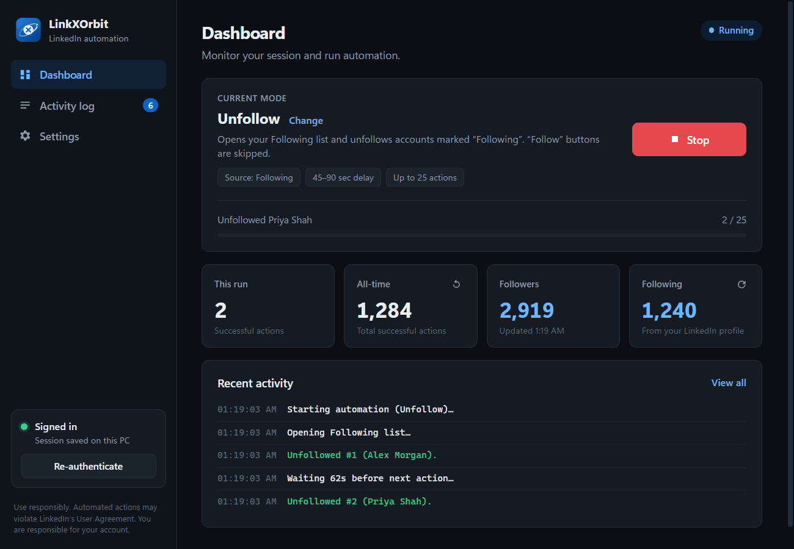

<p align="center">
  
</p>

<h1 align="center">LinkXOrbit</h1>

<p align="center">
  <b>Free, open-source LinkedIn automation for Windows.</b><br/>
  Auto-connect with new people and bulk-unfollow accounts, with safe, human-like pacing. No browser extension, no cloud, no subscription.
</p>

<p align="center">
  <a href="https://github.com/cosmichackerx/LinkXOrbit/releases/latest"></a>
  <a href="https://github.com/cosmichackerx/LinkXOrbit/releases"></a>
  <a href="https://github.com/cosmichackerx/LinkXOrbit/stargazers"></a>
</p>
<p align="center">
  <a href="https://github.com/cosmichackerx/LinkXOrbit/actions/workflows/build-windows.yml"></a>
  
  <a href="LICENSE"></a>
  
  
</p>

<p align="center">
  <a href="#-download">Download</a> ·
  <a href="#-features">Features</a> ·
  <a href="#-getting-started">Getting started</a> ·
  <a href="#-faq">FAQ</a> ·
  <a href="CHANGELOG.md">Changelog</a>
</p>

<p align="center">
  
</p>

> ⭐ **If LinkXOrbit saves you time, please star the repo.** It helps other people find it.

---

## ✨ Features

| | |
| --- | --- |
| 🔐 **One-time sign-in** | Log in to LinkedIn (2FA supported) in a secure window. The session stays on your PC. |
| 🤝 **Auto-Connect** | Opens *My Network → Grow* and sends connection requests automatically. |
| 🧹 **Bulk Unfollow** | Cleans up your *Followers* or *Following* list. Only clicks “Following” and never follows anyone by mistake. |
| ⏱️ **Human-like pacing** | Random delay between actions, a per-run limit, and a run-time estimate. |
| 🛑 **Weekly-limit guard** | Detects LinkedIn’s weekly invitation limit and stops automatically. |
| 📊 **Live dashboard** | Progress bar, this-run and all-time counters, live follower and following counts. |
| 📝 **Activity log** | Timestamped, color-coded log you can copy. |
| 🔒 **Private by design** | No servers and no telemetry. Everything stays local. |

## 📥 Download

1. Go to **[Releases → Latest](https://github.com/cosmichackerx/LinkXOrbit/releases/latest)**.
2. Download **`LinkXOrbit-Setup-<version>.exe`**.
3. Run the installer. If Windows SmartScreen warns you (the installer isn’t code-signed), click **More info → Run anyway**.

## 🚀 Getting started

1. **Sign in.** Click *Sign in to LinkedIn*, finish login and 2FA, then close the LinkedIn window.
2. **Choose a mode.** In *Settings*, pick **Grow network** or **Unfollow** (Followers or Following list), set delays and limits, then *Save changes*.
3. **Start.** Click *Start connecting* or *Start unfollowing*. Click **Stop** at any time.

Defaults: 45–90 seconds between actions, up to 15 actions per run. Start small and increase slowly.

## ❓ FAQ

<details>
<summary><b>Is LinkXOrbit free?</b></summary>
Yes. It’s 100% free and open source under the MIT license.
</details>

<details>
<summary><b>Where is my LinkedIn login stored?</b></summary>
Only on your computer, in the app’s private Electron profile (<code>userData</code>). Nothing is uploaded anywhere.
</details>

<details>
<summary><b>Can my LinkedIn account get restricted?</b></summary>
Possibly. Any automation may break LinkedIn’s User Agreement. Use long delays and small limits, and watch your account. LinkXOrbit stops automatically when LinkedIn’s weekly limit message appears.
</details>

<details>
<summary><b>Does it work on macOS or Linux?</b></summary>
Only Windows is officially built today. It’s Electron, so you can run it from source with <code>npm start</code> on other platforms. Pull requests for macOS and Linux builds are welcome.
</details>

<details>
<summary><b>It got stuck. What should I do?</b></summary>
LinkedIn changes its pages often. Open a <a href="https://github.com/cosmichackerx/LinkXOrbit/issues/new/choose">bug report</a> with your Activity log and a screenshot.
</details>

## 🛠️ Development

```powershell
git clone https://github.com/cosmichackerx/LinkXOrbit.git
cd LinkXOrbit
npm ci
npm start          # build and run
npm run pack:win   # build the installer -> release/LinkXOrbit-Setup-<version>.exe
npm run icons      # regenerate icons from build/icon.svg
```

Built with Electron + TypeScript and packaged with electron-builder (NSIS). Pushing a `v*` tag builds the installer and publishes a GitHub Release. See [CONTRIBUTING.md](CONTRIBUTING.md) to get involved.

## 🗺️ Roadmap

- [ ] Personalized connection notes
- [ ] Withdraw old pending invitations
- [ ] Scheduling (run at set times)
- [ ] macOS and Linux builds

Have an idea? [Open a feature request](https://github.com/cosmichackerx/LinkXOrbit/issues/new/choose).

## ⭐ Star history

<a href="https://star-history.com/#cosmichackerx/LinkXOrbit&Date">
  
</a>

## ⚠️ Disclaimer

LinkXOrbit is not affiliated with or endorsed by LinkedIn. Automating actions may conflict with [LinkedIn’s User Agreement](https://www.linkedin.com/legal/user-agreement). Use conservative limits; you are responsible for how you use this tool.

## 📄 License

[MIT](LICENSE) © cosmichackerx

<sub>Keywords: LinkedIn automation tool, LinkedIn auto connect, LinkedIn bulk unfollow, LinkedIn connection bot, grow LinkedIn network, LinkedIn followers cleaner, Windows desktop app.</sub>
